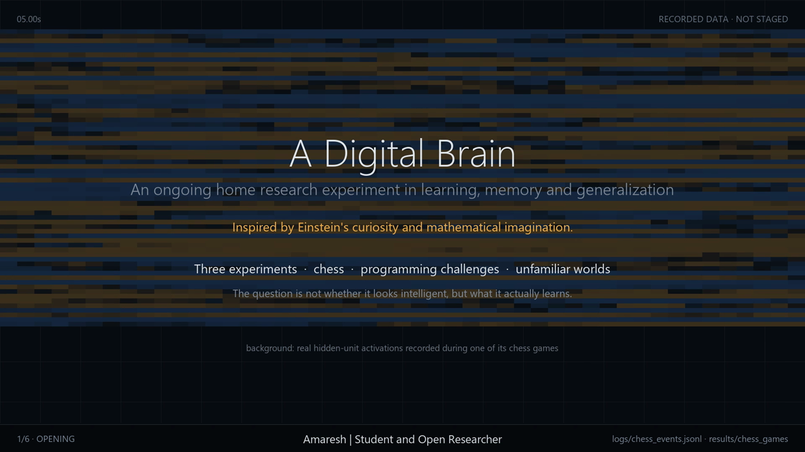
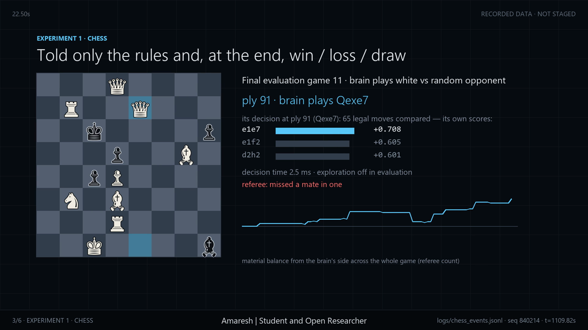
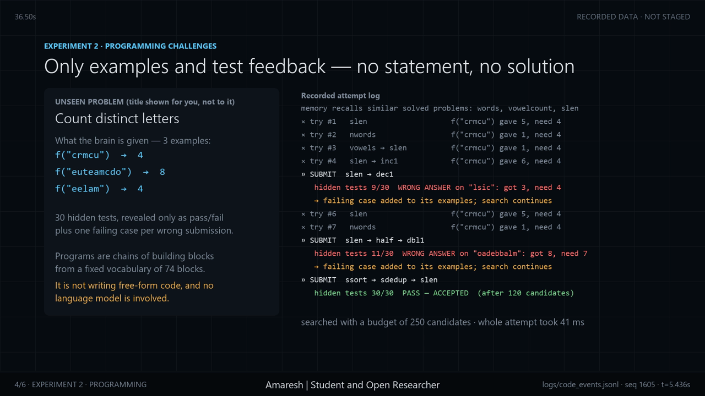
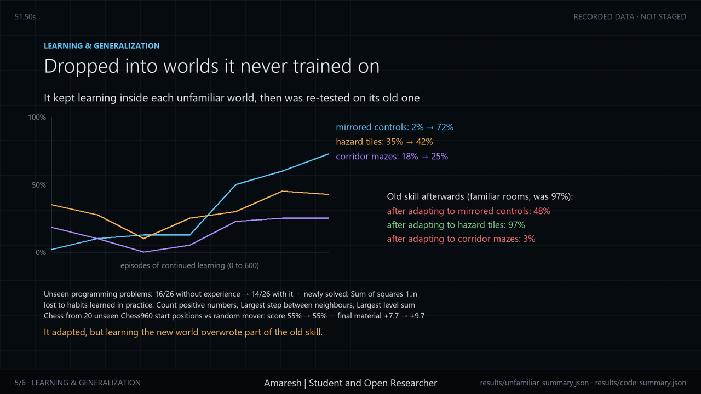

# Einstein's Brain: a home research experiment

Amaresh | Student and Open Researcher

This is a small artificial learning system that started from zero. I gave it three kinds of challenge (chess, programming problems and worlds it had never seen) and recorded what it did, what changed with practice, where it failed and what it never learned.

The name comes from Einstein's habit of learning through experiments. The system has none of his knowledge. It starts knowing nothing, and the experiments measure how much it picks up on its own.

Watch the 60-second research film: [film/digital_brain_research_film.mp4](film/digital_brain_research_film.mp4)

Full result tables: [REPORT.md](REPORT.md)



## Timeline

The idea came from reading about Google DeepMind's virtual fruit fly. I built and ran the experiments, the film and this write-up on October 28, 2026, on one home computer, and the timestamps in the logs and commits are from that day. The chess training alone took about 20 minutes.

## Research questions

- What does it learn when nobody gives it the solution?
- Does its behaviour change measurably with experience?
- Do its skills carry over to challenges it has never seen?
- What happens when it fails, gets stuck or the rules change?

Each result is compared with the same brain before learning, or with simple baselines such as random play and a beginner copy that has no experience.

## How it was trained

### Chess

The brain got the rules and, after each game, one word: win, loss or draw. Nobody told it what the pieces are worth, how to open or what a tactic is. It played 8,000 practice games against itself, a random player and a player that always grabs the biggest capture. It kept a memory of the positions it had played and gradually learned to predict, from any position, how likely it was to win. On its turn it scores every legal move by the position that move leads to and plays the highest score. Early on it tries a random move 30% of the time, and that drops to 5% as it learns.

### Programming challenges

This works like LeetCode with the problem statement removed. For each problem the brain sees three input and output examples. A submission runs against 30 hidden tests. If it fails, the brain gets one failing case back, adds it to its examples and searches again. It builds programs by chaining 74 basic building blocks and may check at most 250 candidate programs per attempt. With practice it learned which blocks tend to work together and invented one new block from a pattern it kept reusing. It also remembers the problems it has solved and recalls similar ones later. It practised on 35 problems covering arrays, strings, recursion, dynamic programming, graphs and trees. Then I tested it on 26 problems it had never seen.

### Unfamiliar worlds

The brain learned to reach a goal in small rooms. It was rewarded for arriving and lost a little for every wasted step or bump into a wall. It sees a small window around itself and remembers where it has already been. After 3,000 practice rooms I put it, without warning, into bigger rooms, winding corridor mazes, rooms with deadly hazard tiles and rooms with mirrored controls. Then I let it keep learning in each new world and re-tested it on the old rooms.

### Recording

Every decision was logged with synchronised timestamps, along with the alternatives it scored, its rewards, memory updates, test results and hidden-unit activations. The film is drawn entirely from those logs. A separate referee, which is not part of the brain, labels chess blunders and checks puzzle answers.

## Results

| | Before learning | After learning |
|---|---|---|
| Chess: win a free queen (100 unseen puzzles) | 22% | 44% (random guessing gets about 25%) |
| Chess: material balance against a random player | +3.0 | +16.7 |
| Chess: score against a random player | 46% | 61% |
| Programming: median attempts on practice problems | 13 | 4 |
| Navigation: success in new rooms | 3% | 97% |
| Navigation: mirrored controls, after more learning | 2% | 72% |




## What it never learned

In chess it wins material but rarely finishes the game with checkmate. It misses mate in one, has never beaten a player that looks one capture ahead, and solves mate-in-two puzzles only 7% of the time, close to guessing.

On the 26 unseen programming problems it solved 14 after practice, while the beginner copy solved 16. Remembering a related problem let it crack a new one (sum of squares from 1 to n). The habits it picked up in practice also steered it away from three problems the beginner solved.

In unfamiliar worlds it reached the goal in only 18% of corridor mazes, mostly because it walked in loops until time ran out. It walked straight into hazard tiles it had never seen. Learning a new world also wiped out part of the old skill: after learning mirrored controls its success in ordinary rooms fell from 97% to 48%, and after learning mazes it fell to 3%.



## What is in this repository

- [film/](film/): the 60-second research film
- [figures/](figures/): stills from the film
- [evidence/](evidence/): headline metrics and short excerpts of the timestamped event logs, covering one chess evaluation game, two programming attempts and the navigation tests
- [REPORT.md](REPORT.md): all result tables, including every unseen programming problem and every failure
- [src/brain/](src/brain/): the code for the three experiments
- [src/film/](src/film/): the code that draws the film, composes its music and writes the report from the recorded results

The trained networks and the full logs (about 240 MB) are not included, but the code regenerates them.

## Run it yourself

You need Python 3.10 or newer and [ffmpeg](https://ffmpeg.org/) on your path.

```
pip install -r requirements.txt
cd src/brain
python exp_code.py
python exp_unfamiliar.py
python exp_chess.py 8000 1000
cd ../film
python render.py
python make_report.py
```

The programming and navigation experiments take a few minutes each and are seeded, so they reproduce the published numbers exactly. The chess run takes about 25 minutes on an ordinary home computer; its seeds are fixed too, but small timing differences between machines can change individual games. Everything is written to `src/logs/`, `src/results/` and `src/film_output/`. The film code uses fonts that ship with Windows (Segoe UI, Consolas and Segoe UI Symbol), so on another system you need to change the font paths at the top of `render.py`.

## Rights

© 2026 Amaresh. All rights reserved; see [LICENSE](LICENSE). You may view this repository, share links to it, and download and run the code to review or check the results. Any other copying or reuse needs my written permission.
